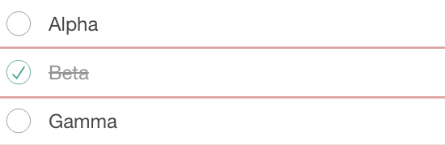
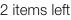
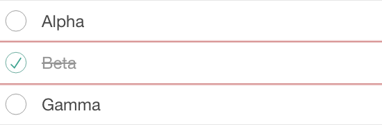
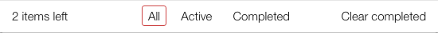

## Trigger
<Link to refactor PR>

## Summary
- 4 selectors recovered
- 1 test files updated
- 0 flagged for manual review

## Per-file changes
### todo-ui.mjs
| Line | Old | New | Score | Shot |
|---|---|---|---|---|
| 4 | `page.locator('.todo-list')` | `page.getByRole('list').filter({ hasNot: page.getByRole('link') })` | 3 |  |
| 10 | `page.locator('.todo-count')` | `page.getByText(/^\d+ items? left$/)` | 2 |  |
| 11 | `page.locator('.todoapp .main')` | `page.locator('section.main')` | 1 |  |
| 12 | `page.locator('.todoapp .footer')` | `page.locator('footer.footer')` | 1 |  |

## Flagged for review

## How to review
- Check each screenshot: does `new` point at the same element as `old`?
- For score-3 candidates, verify the region scope is meaningful in the new design.
- For flagged tests, decide: rewrite, delete, or accept a manual update.
